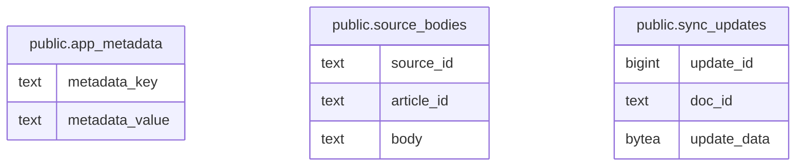

# blog-writer backend

## Tables

| Name                                            | Columns | Comment                                       | Type       |
| ----------------------------------------------- | ------- | --------------------------------------------- | ---------- |
| [public.app_metadata](public.app_metadata.md)   | 2       | Stores backend metadata as key-value pairs.   | BASE TABLE |
| [public.source_bodies](public.source_bodies.md) | 3       | Stores Markdown bodies for article sources.   | BASE TABLE |
| [public.sync_updates](public.sync_updates.md)   | 3       | Stores encoded Yjs updates for each document. | BASE TABLE |

## Relations

---

> Generated by [tbls](https://github.com/k1LoW/tbls)
