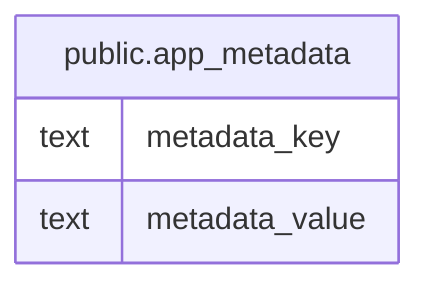

# public.app_metadata

## Description

Stores backend metadata as key-value pairs.

## Columns

| Name           | Type | Default | Nullable | Children | Parents | Comment              |
| -------------- | ---- | ------- | -------- | -------- | ------- | -------------------- |
| metadata_key   | text |         | false    |          |         | Unique metadata key. |
| metadata_value | text |         | false    |          |         | Metadata value.      |

## Constraints

| Name                                 | Type        | Definition                 |
| ------------------------------------ | ----------- | -------------------------- |
| app_metadata_metadata_key_not_null   | n           | NOT NULL metadata_key      |
| app_metadata_metadata_value_not_null | n           | NOT NULL metadata_value    |
| app_metadata_pkey                    | PRIMARY KEY | PRIMARY KEY (metadata_key) |

## Indexes

| Name              | Definition                                                                              |
| ----------------- | --------------------------------------------------------------------------------------- |
| app_metadata_pkey | CREATE UNIQUE INDEX app_metadata_pkey ON public.app_metadata USING btree (metadata_key) |

## Relations

---

> Generated by [tbls](https://github.com/k1LoW/tbls)
