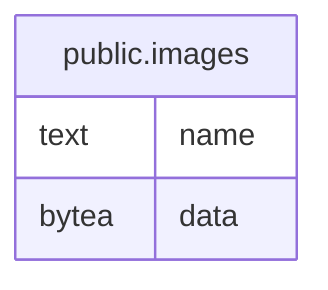

# public.images

## Description

Stores images pasted into article drafts.

## Columns

| Name | Type  | Default | Nullable | Children | Parents | Comment                                                      |
| ---- | ----- | ------- | -------- | -------- | ------- | ------------------------------------------------------------ |
| name | text  |         | false    |          |         | File name made of the SHA-256 of the data and its extension. |
| data | bytea |         | false    |          |         | Encoded image bytes.                                         |

## Constraints

| Name                 | Type        | Definition         |
| -------------------- | ----------- | ------------------ |
| images_data_not_null | n           | NOT NULL data      |
| images_name_not_null | n           | NOT NULL name      |
| images_pkey          | PRIMARY KEY | PRIMARY KEY (name) |

## Indexes

| Name        | Definition                                                          |
| ----------- | ------------------------------------------------------------------- |
| images_pkey | CREATE UNIQUE INDEX images_pkey ON public.images USING btree (name) |

## Relations

---

> Generated by [tbls](https://github.com/k1LoW/tbls)
