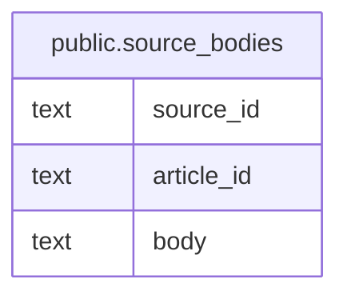

# public.source_bodies

## Description

Stores Markdown bodies for article sources.

## Columns

| Name       | Type | Default | Nullable | Children | Parents | Comment                                                  |
| ---------- | ---- | ------- | -------- | -------- | ------- | -------------------------------------------------------- |
| source_id  | text |         | false    |          |         | Unique source identifier stored in the article document. |
| article_id | text |         | false    |          |         | Article identifier from the article document.            |
| body       | text |         | false    |          |         | Imported or user-provided Markdown body.                 |

## Constraints

| Name                              | Type        | Definition                          |
| --------------------------------- | ----------- | ----------------------------------- |
| source_bodies_article_id_not_null | n           | NOT NULL article_id                 |
| source_bodies_body_not_null       | n           | NOT NULL body                       |
| source_bodies_source_id_not_null  | n           | NOT NULL source_id                  |
| source_bodies_pkey                | PRIMARY KEY | PRIMARY KEY (article_id, source_id) |

## Indexes

| Name               | Definition                                                                                         |
| ------------------ | -------------------------------------------------------------------------------------------------- |
| source_bodies_pkey | CREATE UNIQUE INDEX source_bodies_pkey ON public.source_bodies USING btree (article_id, source_id) |

## Relations

---

> Generated by [tbls](https://github.com/k1LoW/tbls)
