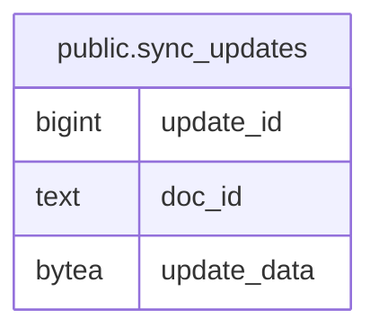

# public.sync_updates

## Description

Stores encoded Yjs updates for each document.

## Columns

| Name        | Type   | Default                                         | Nullable | Children | Parents | Comment                                             |
| ----------- | ------ | ----------------------------------------------- | -------- | -------- | ------- | --------------------------------------------------- |
| update_id   | bigint | nextval('sync_updates_update_id_seq'::regclass) | false    |          |         | Order in which an update was stored for a document. |
| doc_id      | text   |                                                 | false    |          |         | Identifier of the synchronized document.            |
| update_data | bytea  |                                                 | false    |          |         | Encoded Yjs document update.                        |

## Constraints

| Name                              | Type        | Definition              |
| --------------------------------- | ----------- | ----------------------- |
| sync_updates_doc_id_not_null      | n           | NOT NULL doc_id         |
| sync_updates_update_data_not_null | n           | NOT NULL update_data    |
| sync_updates_update_id_not_null   | n           | NOT NULL update_id      |
| sync_updates_pkey                 | PRIMARY KEY | PRIMARY KEY (update_id) |

## Indexes

| Name                              | Definition                                                                                            |
| --------------------------------- | ----------------------------------------------------------------------------------------------------- |
| sync_updates_pkey                 | CREATE UNIQUE INDEX sync_updates_pkey ON public.sync_updates USING btree (update_id)                  |
| sync_updates_doc_id_update_id_idx | CREATE INDEX sync_updates_doc_id_update_id_idx ON public.sync_updates USING btree (doc_id, update_id) |

## Relations

---

> Generated by [tbls](https://github.com/k1LoW/tbls)
